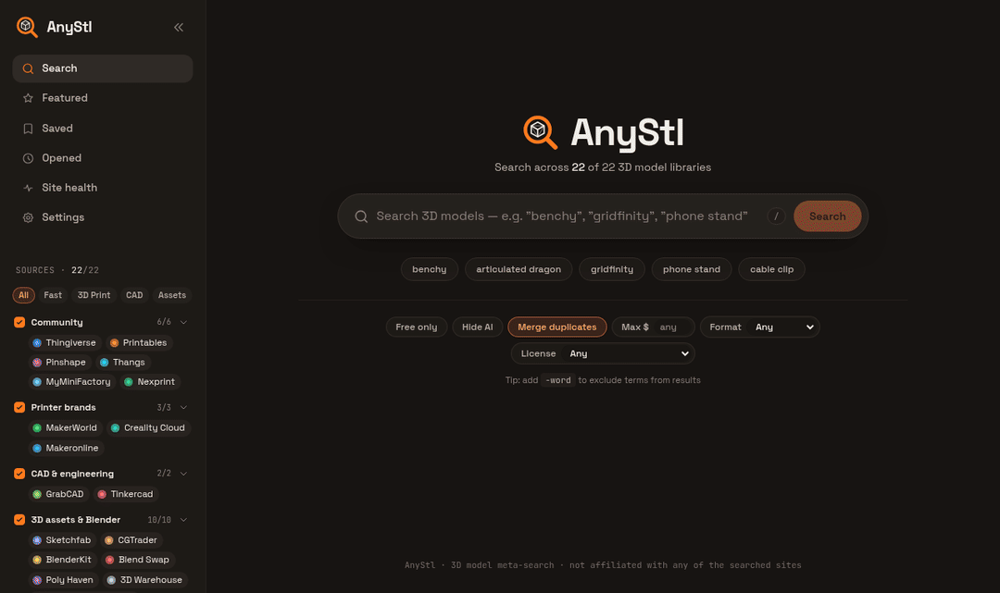

<div align="center">
  
  <h1>AnyStl</h1>
  <p><strong>Local 3D model meta-search across 22+ printing, CAD, and 3D asset libraries.</strong></p>
  <p>
    <a href="https://github.com/KaNEX-01/AnyStl/releases"><strong>Download Desktop App</strong></a> ·
    <a href="#quick-start">Quick Start</a> ·
    <a href="#supported-sources">Sources</a> ·
    <a href="orcaslicer/README.md">OrcaSlicer Plugin</a>
  </p>
</div>

<p align="center">
  
</p>

## Highlights

- **One search, 22+ libraries** — live streaming results with per-site status, fair cross-site ranking, and `-word` exclusions.
- **Instant filtering** — filter by free-only, hide AI, max price, file format (`STL`, `3MF`, `STEP`…), license (CC commercial / noncommercial), and duplicate merging.
- **Quick preview & compare** — inspect images, formats, licenses, and dimensions in-app, or compare up to 3 models side by side.
- **Send to Slicer** — open STL/3MF models straight in **OrcaSlicer**, **Bambu Studio**, **PrusaSlicer**, **Elegoo Slicer**, or direct download (Printables, Thingiverse, free MyMiniFactory, Wikimedia Commons).
- **Saved collections & Featured** — bookmark models locally into collections, check for dead links, find alternatives, and browse featured models.
- **OrcaSlicer tab plugin** — [`orcaslicer/anystl.py`](orcaslicer/anystl.py) adds an AnyStl tab directly inside OrcaSlicer 2.5.1+ with zero external dependencies.
- **100% local** — runs on your own machine; searches go straight to each model site with no middleman server.

## Quick Start

### Desktop App & App Launcher (Windows & Linux — Recommended)

Download the latest release from [GitHub Releases](https://github.com/KaNEX-01/AnyStl/releases) — opens in a native window with no terminal, no Node.js install, and no build step:

- **Windows:** run `AnyStl_*_x64-setup.exe` (installs to your **Start Menu** & **Desktop**, no admin rights needed) or unzip `AnyStl-windows-x64-portable.zip` and launch `AnyStl.exe`.
- **Linux:** install `AnyStl_*_amd64.deb` (adds **AnyStl** to your **App Launcher** / application menu), run `AnyStl_*_amd64.AppImage`, or extract `AnyStl-linux-x64-portable.tar.gz`.

### Install App Launcher from Source

```bash
git clone https://github.com/KaNEX-01/AnyStl.git
cd AnyStl
```

- **Linux App Launcher (`.desktop` entry + `~/.local/bin/anystl`):** `npm run desktop:install-linux` *(requires Rust & `webkit2gtk-4.1`)*
- **Windows App Launcher (Start Menu & Desktop shortcut):** `powershell -ExecutionPolicy Bypass -File desktop\install-windows.ps1 -DesktopShortcut`
- **Browser only (no desktop build):** run `start.cmd` (Windows) or `./start.sh` (Linux/macOS, Node.js 20+) → opens `http://localhost:3000`.

## Supported Sources

| Category | Sites |
| --- | --- |
| **3D Printing** | Thingiverse, Printables, Pinshape, Thangs, MyMiniFactory, Nexprint |
| **Printer Brands** | MakerWorld, Creality Cloud, Makeronline |
| **CAD & Engineering** | GrabCAD, Tinkercad *(+ TraceParts with API key)* |
| **3D Assets & Blender** | Sketchfab, CGTrader, BlenderKit, Blend Swap, Poly Haven, 3D Warehouse, Wikimedia Commons, TurboSquid, Free3D, CadNav |
| **Meta / External** | Yeggi *(covers Cults3D, Gambody, etc.)* · direct links for Cults3D, Fab, STLFinder |

## Optional Configuration & Development

<details>
<summary><strong>Optional API keys, API-only / SearXNG mode, and Linux Xvfb</strong></summary>

Copy `.env.example` to `.env.local` and set only what you need, then restart AnyStl:

| Variable | Purpose |
| --- | --- |
| `THINGIVERSE_ACCESS_TOKEN` | Use official Thingiverse API instead of Playwright |
| `MYMINIFACTORY_API_KEY` | Use official MyMiniFactory API instead of sitemap fallback |
| `CGTRADER_ACCESS_TOKEN` | Use official CGTrader OAuth API instead of Playwright |
| `CULTS3D_USERNAME` + `CULTS3D_API_KEY` | Enable direct Cults3D GraphQL search |
| `TRACEPARTS_*` | Enable authorized TraceParts catalog search (see `.env.example`) |
| `ANYSTL_NO_BROWSER=1` | Run in fast API/HTTP-only mode without launching Chromium |
| `SEARXNG_URL` | Use a local SearXNG JSON endpoint as fallback for browser-scraped sites |

**Linux note:** TurboSquid and Free3D require a virtual display (`Xvfb`, e.g. `sudo apt install xvfb` or `sudo pacman -S xorg-server-xvfb`); without it they are skipped and offered as external links.

</details>

<details>
<summary><strong>Running tests</strong></summary>

```bash
bash scripts/test-apis.sh                  # Offline API & metadata suites
bash scripts/test-apis.sh --live           # Live API checks
bash scripts/test-orcaslicer-plugin.sh     # OrcaSlicer plugin tests
npm run build && npm run smoke             # End-to-end live smoke test
```

</details>

---

Built with **Next.js 16**, **React 19**, **TypeScript**, **Tailwind CSS 4**, **Playwright**, and **Tauri v2**.
